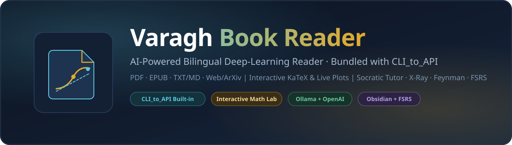
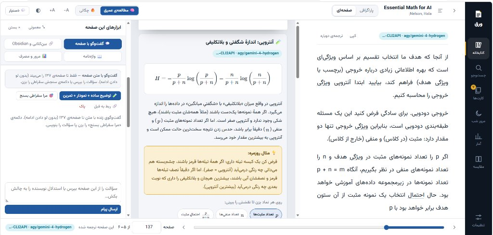
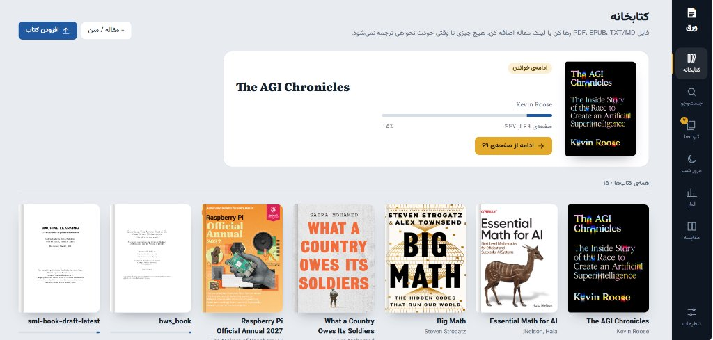
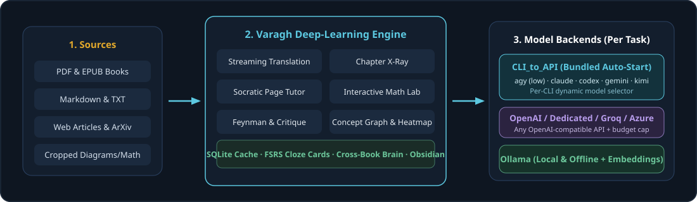

<div dir="rtl">

<p align="center">
  
</p>

<p align="center">
  <b>🇮🇷 فارسی</b> &nbsp;|&nbsp; <a href="README.md">🇬🇧 English README</a>
</p>

# ورق (Varagh) — کتاب‌خوان هوشمند دوزبانه و آزمایشگاه یادگیری عمیق

**ورق** یک اپلیکیشن محلی و متن‌باز برای خواندن **سریع‌تر و عمیق‌تر** کتاب‌ها، مقالات و متون انگلیسی (به فارسی) است که به‌طور پیش‌فرض با **[`CLI_to_API`](https://github.com/alipyth/CLI_to_API)** یکپارچه شده و همه‌چیز روی کامپیوتر خودت اجرا می‌شود.

فایل **PDF، EPUB، TXT، Markdown** یا **لینک مقاله / ArXiv** را وارد کن و به‌جای مطالعه‌ی منفعل، هر صفحه را به یک آزمایشگاه یادگیری تعاملی تبدیل کن: ترجمه‌ی استریمی، رندر واقعی فرمول‌های ریاضی (KaTeX) با **نمودارهای زنده و اسلایدر**، استاد سقراطیِ کنار صفحه، پیش‌خوانی X-Ray، آزمون فاینمن، نقد کتاب، گراف مفاهیم، نقشه‌ی حرارتی چگالی اطلاعات، فلش‌کارت‌های مفهومی FSRS و خروجی مستقیم **Obsidian**.

## تصاویر واقعی برنامه

<p align="center">
  
  <br>
  <sub><b>صفحه‌ی خواندن و آزمایشگاه تعاملی فرمول:</b> ترجمه‌ی فارسی روان، رندر واقعی فرمول‌ها با KaTeX، مثال روزمره، چیپ‌های قابل کلیک نمادها و پنل دستیار سقراطی متصل به <code>CLI_to_API</code>.</sub>
</p>

<p align="center">
  
  <br>
  <sub><b>کتابخانه:</b> مدیریت کتاب‌های PDF، EPUB، TXT/MD و مقالات وب/ArXiv با نمایش جلد و پیشرفت مطالعه.</sub>
</p>

---

## اتصال خودکار به [`CLI_to_API`](https://github.com/alipyth/CLI_to_API) در کنار OpenAI و Ollama

نسخه‌ی کامل **[`CLI_to_API`](https://github.com/alipyth/CLI_to_API)** درون پوشه‌ی `cli_to_api/` همراه خود پروژه قرار دارد و **به‌محض اجرای ورق، به‌طور خودکار راه‌اندازی می‌شود** (بدون نیاز به اجرای دستی سرور جداگانه):

- **پشتیبانی از همه‌ی CLIهای محلی:** `agy`، `claude`، `codex`، `gemini`، `kimi`، `cline`، `opencode`، `cursor`، `copilot`، `qwen` و `ollama-cli`.
- **CLI پیش‌فرض `agy` روی حالت `low`:** همه‌ی مدل‌های موجود در `agy` به‌صورت خودکار شناسایی می‌شوند و با `--effort low` سریع و بهینه اجرا می‌شوند.
- **انتخاب مدل برای هر CLI و هر کار:** در بخش **تنظیمات** می‌توانی برای هر کار (ترجمه‌ی پاراگرافی، ترجمه‌ی صفحه‌ای، ترجمه‌ی بهتر، واژه‌نامه، توضیح عمیق و…) اول **ارائه‌دهنده** (`CLI2API` / `OpenAI` / `Ollama`) و در حالت `CLI2API` اول **CLI** و سپس **هر مدلی که داخل آن CLI هست** را انتخاب کنی.
- **حفظ کامل OpenAI اختصاصی و Ollama:** اتصال به هر سرویس سازگار با OpenAI (مثل Groq، OpenAI، Azure یا endpoint اختصاصی با سقف بودجه‌ی ماهانه) و همین‌طور **Ollama** (از جمله جست‌وجوی معنایی آفلاین با `bge-m3`) کاملاً فعال و در دسترس است.

<p align="center">
  
</p>

---

## نصب و اجرای سریع (با یک کلیک)

**پیش‌نیاز:** Python **3.10 یا جدیدتر** (به‌همراه حداقل یکی از CLIهای محلی مثل `agy`/`claude`/`codex` یا `Ollama` یا کلید `OpenAI`).

### ویندوز
```bat
git clone https://github.com/alipyth/varagh_book_reader.git
cd varagh_book_reader
run.bat
```

### لینوکس و مک
```bash
git clone https://github.com/alipyth/varagh_book_reader.git
cd varagh_book_reader
chmod +x run.sh
./run.sh
```

در اجرای اول، محیط مجازی `.venv` ساخته و کتابخانه‌ها نصب می‌شوند؛ سپس سرور `CLI_to_API` در پس‌زمینه روی `127.0.0.1:8787` بالا می‌آید و ورق روی آدرس **`http://127.0.0.1:8765`** در مرورگر باز می‌شود.

---

## امکانات اصلی

### مطالعه و ورودی‌های متنوع
- **پشتیبانی چندفرمتی:** آپلود **PDF**، **EPUB**، **TXT**، **Markdown**، وارد کردن **لینک مقاله وب / ArXiv** یا چسباندن مستقیم متن.
- **ترجمه‌ی استریمی و هوشمند:** هیچ متنی بدون دستور تو ترجمه نمی‌شود؛ هر پاراگراف فقط یک بار ترجمه و در SQLite ذخیره می‌شود (مشترک بین حالت پاراگرافی و صفحه‌ای).
- **واژه‌نامه‌ی یکپارچه و معنی کلمه:** انتخاب هر کلمه در متن انگلیسی ← معنی در همان جمله، تلفظ و تبدیل با یک کلیک به کارت FSRS.

### ۱۰ ابزار یادگیری عمیق و سریع
1. **🩻 پیش‌خوانی فصل (Chapter X-Ray):** قبل از شروع فصل، در چند ثانیه تز اصلی، ادعاهای کلیدی، سؤال‌های فصل و راهنمای «کجا عمیق بخوانی / کجا سریع رد شوی» را می‌بینی.
2. **💬 گفت‌وگو با صفحه (استاد سقراطی):** سایدبار قابل بزرگ‌نمایی و تغییر عرض که فقط تا صفحه‌ی فعلی را می‌بیند (بدون لو دادن ادامه)، همراه با دکمه‌های سریع **«🧪 توضیح ساده + نمودار + تمرین»**، **«🎯 مرا سقراطی بسنج»** و **«🔗 ربط به قبل»**.
3. **🧪 آزمایشگاه تعاملی فرمول و نمودار:** در حالت صفحه‌ای، روی هر فرمول یا نمودار PDF/EPUB کادر بکش ← فرمول با **KaTeX** رندر می‌شود، توضیح ساده و مثال روزمره می‌دهد، چیپ‌های قابل کلیک برای هر نماد دارد، **نمودار SVG زنده با اسلایدرهای تعاملی** می‌کشد و **۲ تمرین چندگزینه‌ای فوری** می‌دهد.
4. **✍️ آزمون فاینمن زنده:** مفهوم فصل را با کلمه‌های خودت (متنی یا با **🎤 گفتار به متن فارسی**) توضیح بده تا مدل امتیاز فهم، شکاف‌های دقیق، پیش‌فرض‌های پنهان و نقل‌قول کتاب را بهت نشان دهد.
5. **🕸️ گراف مفاهیم و استدلال‌ها:** استخراج مفاهیم، ادعاها، شواهد و رابطه‌های منطقی (`حمایت`، `نقض`، `وابستگی`، `علیت`) به‌صورت گراف تعاملی.
6. **🗂️ کارت‌های یادآوری مفهومی و جای‌خالی (FSRS):** ساخت خودکار ۳ کارت عمیق از هر پاراگراف (**علت و مکانیزم**، **جای‌خالی Cloze** و **سناریوی کاربردی**) با الگوریتم مرور فاصله‌دار FSRS.
7. **🎚️ توضیح ۴ سطحی آنی روی هر پاراگراف:** `شهودی (ELI5)` | `دقیق و فنی` | `مقایسه با مفاهیم مشابه` | `قیاس با حوزه‌ی تخصصی خودت` (قابل تنظیم در تنظیمات).
8. **⚖️ نقد کتاب و وکیل مدافع شیطان:** اول قوی‌ترین صورت استدلال نویسنده (Steelman) و بعد قوی‌ترین نقدها، متفکران رقیب و نقاط کور فصل.
9. **🔥 نقشه‌ی حرارتی چگالی اطلاعات:** رنگ‌بندی پاراگراف‌های صفحه به 🟡 **محوری**، 🔵 **مثال** و ⚪ **تکرار/حاشیه** + فیلتر «فقط محوری».
10. **🔗 مغز دوم بین‌کتابی و خروجی Obsidian:** کشف خودکار ارتباط ایده‌های این صفحه با کتاب‌های دیگرِ کتابخانه‌ات (بدون نیاز به Ollama) + دانلود فایل `.md` یا همگام‌سازی مستقیم با پوشه‌ی **Obsidian Vault**.

---

## حریم خصوصی و داده‌ها

همه‌ی کتاب‌ها، ترجمه‌ها، کارت‌ها و کلیدهای API فقط به‌صورت محلی در پوشه‌ی `data/` ذخیره می‌شوند (این پوشه در `.gitignore` است و هرگز به گیت‌هاب ارسال نمی‌شود).

## پروژه‌ی مرتبط

- **[CLI_to_API](https://github.com/alipyth/CLI_to_API)** — تبدیل CLIهای هوش مصنوعی محلی به API سازگار با OpenAI.

</div>
