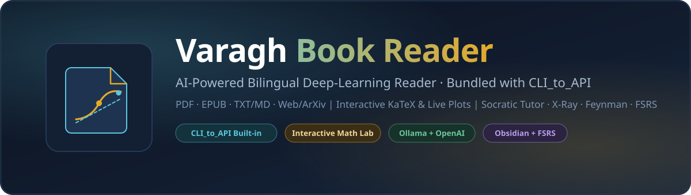
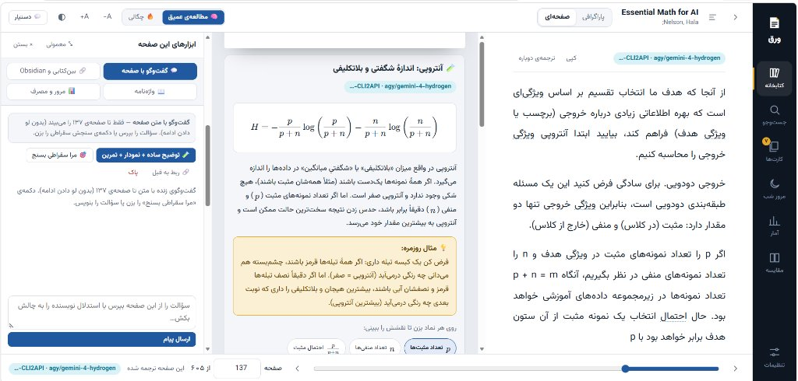
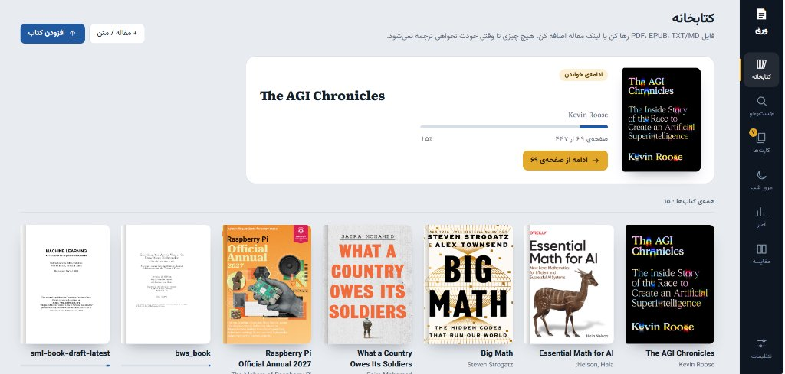
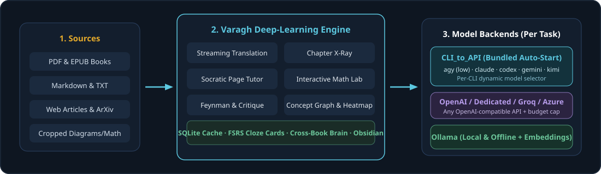

<p align="center">
  
</p>

<p align="center">
  <b>🇬🇧 English</b> &nbsp;|&nbsp; <a href="README.fa.md">🇮🇷 راهنمای فارسی (Persian README)</a>
</p>

<p align="center">
  <a href="https://github.com/alipyth/CLI_to_API"></a>
  
  
  
  
</p>

# Varagh Book Reader (ورق)

**Varagh** is a local-first, AI-powered **bilingual deep-learning book reader** designed for people who want to read dense English books, papers, and technical texts **faster and much deeper** in Persian (Farsi) — with **built-in [`CLI_to_API`](https://github.com/alipyth/CLI_to_API)** support out of the box!

Drop a **PDF, EPUB, TXT, Markdown file, or Web/ArXiv URL** into Varagh and turn passive reading into an active, interactive learning lab: live streaming translation, interactive KaTeX formulas with tunable curve sliders, a spoiler-free Socratic tutor, Chapter X-Ray, Feynman checks, Devil's Advocate critiques, Concept Graphs, Information Density Heatmaps, Conceptual FSRS flashcards, and 1-click Obsidian export.

## Screenshots

<p align="center">
  
  <br>
  <sub><b>Interactive Reader:</b> Streaming Persian translation, KaTeX formula lab with everyday analogy &amp; clickable symbol chips, and resizable Socratic Tutor sidebar powered by <code>CLI_to_API</code>.</sub>
</p>

<p align="center">
  
  <br>
  <sub><b>Library:</b> PDF, EPUB, TXT/MD, and Web/ArXiv articles with reading progress &amp; cover previews.</sub>
</p>

---

## Built-in [`CLI_to_API`](https://github.com/alipyth/CLI_to_API) + OpenAI + Ollama

Varagh ships with **[`CLI_to_API`](https://github.com/alipyth/CLI_to_API)** bundled inside `cli_to_api/` and **auto-starts it automatically** when you run Varagh — no separate setup required!

- **Use your local AI CLIs directly** (`agy`, `claude`, `codex`, `gemini`, `kimi`, `cline`, `opencode`, `cursor`, `copilot`, `qwen`, `ollama-cli`).
- **Default CLI: `agy` in `low` effort mode** — dynamically discovers every model via `agy models` and prioritizes `-low` variants for fast, affordable book reading.
- **Per-CLI Model Selection:** Pick any CLI and choose any model available inside that CLI (or enter a custom model) independently for each task.
- **Keep OpenAI Dedicated & Ollama:** Existing **OpenAI-compatible / Dedicated / Groq / Azure** endpoints (with monthly token budget guard) and **local Ollama** (including offline semantic search via `bge-m3`) work right alongside `CLI_to_API`.

<p align="center">
  
</p>

---

## Quick Start (One Click)

**Prerequisite:** Python **3.10+** (and any local AI CLI such as `agy`, `claude`, `codex`, or Ollama / an OpenAI API key).

### Windows
```bat
git clone https://github.com/alipyth/varagh_book_reader.git
cd varagh_book_reader
run.bat
```

### Linux / macOS
```bash
git clone https://github.com/alipyth/varagh_book_reader.git
cd varagh_book_reader
chmod +x run.sh
./run.sh
```

On first run, Varagh creates `.venv`, installs dependencies, **automatically launches the bundled `CLI_to_API` gateway** on `http://127.0.0.1:8787`, and opens the reader in your browser at **`http://127.0.0.1:8765`**.

### Docker
```bash
docker compose up -d
```
Then open **`http://127.0.0.1:8765`**. Your data lives in the `varagh-data` volume. Ollama on the host is reached at `host.docker.internal:11434`. AI CLIs installed on your host (`agy`, `claude`, `codex`) aren't available inside the container, so either use Ollama/OpenAI, or run `CLI_to_API` on the host and set `VARAGH_CLI2API_URL: http://host.docker.internal:8787` in `docker-compose.yml`. The port is published on localhost only; phone access over Wi-Fi isn't supported in the container.

---

## Key Features

### Reading & Multi-Format Ingestion
- **English or Persian interface:** The app opens in English (left-to-right); switch to a Persian right-to-left interface under **Settings → Interface language**. Translations stay in Persian either way.
- **Multi-format Library:** Import **PDF**, **EPUB**, **TXT**, **Markdown**, **Web Articles / ArXiv URLs**, or paste text directly.
- **On-Demand Streaming Translation:** Nothing is translated until you click. Paragraph-by-paragraph (Side-by-side, Stacked, or Persian-only) and Whole-Page modes share the exact same SQLite cache.
- **Smart Book Glossary & Word Lookup:** Extract consistent domain terminology and select any English word/phrase for contextual meaning, IPA pronunciation, and 1-click FSRS card creation.

### 10 Deep-Learning Tools Built Into the Reader
| # | Tool | What It Does |
|---|---|---|
| 1 | **Chapter X-Ray** | 60-second pre-reading blueprint: central thesis, core claims with page links, key questions, and what to read slowly vs. skim. |
| 2 | **Socratic Page Tutor** | Spoiler-free resizable chat sidebar grounded strictly up to your current page, with **Practice + Plot**, **Socratic Grill**, and **Connect to Prior Pages** shortcuts. |
| 3 | **Interactive Math & Diagram Lab** | Drag a box over any PDF/EPUB formula or diagram → get **KaTeX-rendered math**, plain-language intuition, everyday analogy, clickable symbol chips, **live SVG plots with parameter sliders**, and interactive practice quizzes. |
| 4 | **Live Feynman Check** | Explain a concept in your own words (typing or Persian voice-to-text) → AI pinpoints exact logical gaps, hidden assumptions, and quotes the book back to you. |
| 5 | **Concept & Argument Graph** | Extracts concepts, claims, evidence, and logical relations (`supports`, `contradicts`, `depends_on`, `causes`) as an interactive graph. |
| 6 | **Conceptual & Cloze FSRS Cards** | 1-click generate 3 high-retention cards from any paragraph (**Causal Why/How**, **Cloze `{{...}}`**, and **Application Scenario**) scheduled with **FSRS**. |
| 7 | **4-Level Depth Explanation** | Instant inline toggle on every paragraph: **ELI5 Intuitive** · **Rigorous Technical** · **Compare & Contrast** · **Analogy to Your Own Domain** (configurable in Settings). |
| 8 | **Devil's Advocate & Critique** | Steelmans the author's thesis first, then surfaces the strongest counterarguments, rival thinkers, blind spots, and overgeneralizations. |
| 9 | **Information Density Heatmap** | Color-codes every paragraph on the page into 🟡 **Core**, 🔵 **Example**, or ⚪ **Fluff**, with a 1-click **"Core Only"** filter. |
| 10 | **Cross-Book Second Brain & Obsidian** | Automatically surfaces related notes, highlights, and passages from *other* books in your library + 1-click **Obsidian `.md` export** or direct **Vault sync**. |

---

## Project Structure

```text
varagh_book_reader/
├── run.py / run.bat / run.sh      # One-click launcher
├── cli_to_api/                    # Bundled CLI_to_API gateway (auto-started)
│   └── cli2api/                   # https://github.com/alipyth/CLI_to_API
├── backend/
│   ├── api.py                     # FastAPI routes
│   ├── providers.py               # CLI_to_API (auto-start) + OpenAI + Ollama
│   ├── deep.py                    # All 10 deep-learning engines + interactive math lab
│   ├── translate.py               # Streaming translation, glossary, lookup, compare
│   ├── ingest.py                  # PDF, EPUB, TXT, MD & Web/ArXiv ingestion
│   ├── study.py / extras.py       # Mind maps, quizzes, recaps, search, stats, export
│   ├── learn.py                   # FSRS spaced-repetition flashcards
│   ├── router.py / config.py      # Per-task model routing & budget guard
│   └── db.py                      # Local SQLite storage (WAL mode)
├── frontend/                      # Zero-build vanilla HTML/CSS/JS + KaTeX + Vazirmatn/Literata
└── docs/assets/                   # Banner, architecture diagram & preview
```

---

## Privacy & Local Data

All your books, translations, flashcards, notes, and API keys stay **100% locally** inside `data/` (excluded from Git via `.gitignore`).

## Related Project

- **[CLI_to_API](https://github.com/alipyth/CLI_to_API)** — Turn local AI CLIs (`agy`, `claude`, `codex`, `gemini`, `kimi`, `ollama`, …) into an OpenAI-compatible HTTP API.
